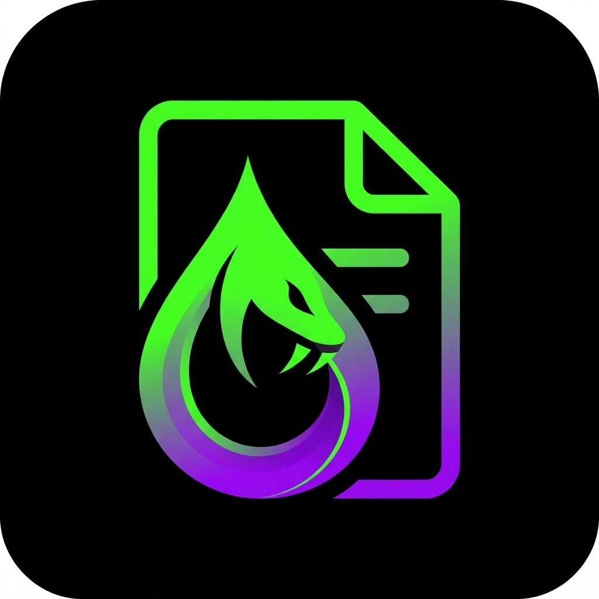
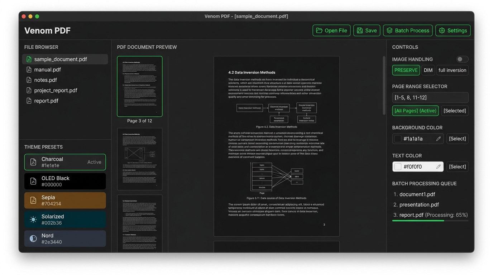

<p align="center">
  
</p>

<h1 align="center">🐍 Venom PDF & Venom-AI</h1>

<p align="center">
  <b>High-Performance Document Layout Intelligence & Native Conversion Engine — Blazing Fast, 100% Offline, Zero Compromises</b>
</p>

<p align="center">
  <a href="https://github.com/singhpratik5/venom-pdf/actions"></a>
  <a href="https://tauri.app"></a>
  <a href="https://onnxruntime.ai"></a>
  <a href="https://fastapi.tiangolo.com"></a>
  <a href="LICENSE"></a>
  
  
</p>

<p align="center">
  
</p>

---

## 🎯 What is Venom PDF & Venom-AI?

**Venom PDF** is an open-source, native desktop application, document intelligence engine, and headless CLI tool that combines low-level vector content stream manipulation with **Machine Learning layout analysis and perceptual contrast optimization**.

Unlike traditional tools that either flatten pages into bloated raster images or execute blind RGB negation that destroys formulas and diagrams, Venom PDF couples a high-performance **Rust vector engine** with **Venom-AI** — a multimodal layout segmentation model running on **ONNX Runtime** (< 0.15 ms/elem) to classify page regions (headings, paragraphs, tables, formulas, figures, code blocks) and optimize reading contrast.

---

## 🔥 Why Venom PDF Outperforms Alternatives

| Problem with Other Tools | Who Does It | What Breaks | The Venom PDF Solution |
|---|---|---|---|
| **Rasterization Bloat** | Online converters (PDF2Go, ConvertIO) | Text is converted to raster images. 2 MB PDF bloats to 60 MB. Search and selection are lost. | **Direct Content Stream Inversion:** Text stays vector, searchable, and sharp at 1000% zoom. File size stays ~2 MB. |
| **Naïve RGB Negation** | PDF dark extensions, basic CLI tools | Photos become creepy negatives. Diagrams turn into eye-burning glare. | **Smart Image Separation:** Raster XObjects are isolated and preserved, dimmed, or inverted per user choice. |
| **View-Only Lock-in** | Adobe Acrobat, SumatraPDF, Okular | Inversion is temporary on screen. Can't export dark mode to colleagues or e-readers. | **Permanent Vector Export:** Saves real, self-contained dark mode PDFs compatible with any viewer. |
| **Privacy Leaks** | Online web services | Sensitive contracts/papers uploaded to third-party cloud servers. | **100% Offline & Local:** Built in Rust. Zero telemetry, zero cloud calls, zero data collection. |
| **Eye Strain & Halation** | Pure `#000` inverted tools | Harsh white text on pitch black causes glare for astigmatism. | **6 Ergonomic Themes:** Rec. 601 luminance mapping with HSL hue preservation and soft charcoal palettes. |

---

## ✨ Key Features

### 🤖 Venom-AI Multimodal Document Intelligence
Integrates a deep neural layout segmentation and region classification pipeline:
- **22-Dimensional Multimodal Feature Vector:** Combines scale-invariant spatial coordinates, typographic linguistics (Shannon entropy, casing ratios, token densities), and visual surface textures.
- **Deep Neural Layout Classifier (ONNX):** Lightweight feedforward network with folded standardization, achieving **0.108 ms / element** inference latency on CPU (**538x faster** than scikit-learn).
- **6 Document Classes:** Accurately distinguishes `paragraph`, `heading`, `table`, `figure`, `formula`, and `code_block`.
- **WCAG AAA Adaptive Contrast Optimizer:** Perceptual color science module dynamically boosting fine formula strokes and tabular grids to guarantee strict accessibility compliance ($\ge 7.0:1$).
- **Live GUI Inspection:** One-click toggle in the React preview displays color-coded layout bounding box overlays with confidence scores.

### 🧠 Smart Vector Inversion Engine
Operates on PDF operators directly using `lopdf`. When a PDF page lacks an explicit background, Venom PDF automatically computes `MediaBox`/`CropBox` dimensions and injects a dark canvas rectangle under the stream, preventing black text on white canvas rendering.

### 🖼️ Intelligent Image Protection (ImageMode)
Automatically isolates image XObjects in the resource dictionary:
- **`Preserve` (Default):** Photos, logos, and raster figures remain in full, untouched color.
- **`Dim`:** Smoothly attenuates brightness by 25% to prevent blinding glare while preserving hues.
- **`Full Invert`:** Inverts raster content (ideal for scanned monochrome line art and black-and-white charts).

### 🎨 6 Curated Ergonomic Themes

| Theme | Background | Foreground | Best For |
|---|---|---|---|
| **Venom Dark** | `#1e1e1e` (Charcoal) | `#d4d4d4` (Soft Gray) | Default balanced dark mode, VS Code style |
| **OLED Black** | `#000000` (Pure Black) | `#f0f0f0` (Pure White) | Battery saving on AMOLED/OLED displays |
| **Dracula** | `#282a36` (Purple Slate) | `#f8f8f2` (Warm White) | Aesthetic dark mode with pastel pink accents |
| **Nord** | `#2e3440` (Arctic Blue) | `#eceff4` (Frost White) | Scandinavian calm, clean reading experience |
| **Sepia** | `#f4ecd8` (Warm Amber) | `#5b4636` (Soft Coffee) | Low-contrast night reading without harsh edges |
| **Solarized** | `#002b36` (Deep Cyan) | `#839496` (Warm Gray) | Precision color balance for technical documentation |

---

## 💻 Headless CLI Mode

Venom PDF includes a headless command-line interface. Run automated conversions in scripts, PowerShell, or CI/CD pipelines without launching the GUI.

```bash
# Invert a single PDF with default Venom Dark theme
venom-pdf -i document.pdf

# Invert with OLED Black theme, dimmed images, and custom output
venom-pdf -i paper.pdf -t "OLED Black" -m dim -o paper_dark.pdf

# Selective page filtering (e.g. pages 1 to 5 and page 8)
venom-pdf -i textbook.pdf -p 1-5,8 -t Dracula

# Multi-threaded batch inversion of an entire folder via Rayon
venom-pdf -b "C:\Documents\PDFs" -d "C:\Documents\Inverted" -t Nord

# List all available themes
venom-pdf --list-themes

# Register Windows Explorer context menu
venom-pdf --register-menu

# Show help manual
venom-pdf --help
```

### CLI Command Options Reference

| Flag | Long Flag | Description | Default |
|---|---|---|---|
| `-i` | `--invert <FILE>` | Single PDF file path to invert | — |
| `-b` | `--batch <DIR>` | Directory containing PDFs to invert in parallel | — |
| `-o` | `--output <FILE>` | Custom output destination path | `<stem>_<theme>.pdf` |
| `-d` | `--output-dir <DIR>` | Output directory for batch processing | `<dir>/venom_inverted` |
| `-t` | `--theme <NAME>` | Color theme preset name | `"Venom Dark"` |
| `-m` | `--image-mode <MODE>`| `preserve`, `dim`, or `invert` | `preserve` |
| `-p` | `--pages <RANGE>` | Page range filter (`all`, `1-5`, `1,3,5-10`) | `"all"` |
| — | `--list-themes` | Display all available themes and hex colors | — |
| — | `--register-menu` | Register right-click menu in Windows Explorer | — |
| — | `--unregister-menu` | Remove right-click menu from Windows Explorer | — |
| `-h` | `--help` | Display CLI documentation | — |
| `-v` | `--version` | Display version information | — |

---

## 🖱️ Windows File Explorer Integration

Right-click any PDF or folder in Windows 10 & 11:
- **Right-click PDF:** `"Invert with Venom PDF (Dark Mode)"` → converts instantly in the background.
- **Right-click Folder:** `"Batch Invert PDFs with Venom PDF"` → inverts all contained PDFs in parallel.
- **No Administrator Rights Needed:** Registered per-user in `HKEY_CURRENT_USER` (`HKCU\Software\Classes\SystemFileAssociations\.pdf`).
- **One-Click Toggle:** Enable or disable with a single click in the app via the **"CLI & Shell"** header button.
- **Standalone `.reg` Files:** [`assets/registry/register-context-menu.reg`](assets/registry/register-context-menu.reg) and [`assets/registry/unregister-context-menu.reg`](assets/registry/unregister-context-menu.reg).

---

## ⌨️ Global Keyboard Shortcuts

| Shortcut | Action |
|---|---|
| <kbd>Ctrl</kbd> + <kbd>O</kbd> / <kbd>⌘</kbd> + <kbd>O</kbd> | Open PDF file picker dialog |
| <kbd>Ctrl</kbd> + <kbd>S</kbd> / <kbd>⌘</kbd> + <kbd>S</kbd> | Export / Save inverted dark mode PDF |
| <kbd>Ctrl</kbd> + <kbd>Shift</kbd> + <kbd>D</kbd> | Load built-in demo document |
| <kbd>F1</kbd> or <kbd>Ctrl</kbd> + <kbd>/</kbd> | Open OS Integration & CLI Cheatsheet modal |
| <kbd>Ctrl</kbd> + <kbd>+</kbd> / <kbd>Ctrl</kbd> + <kbd>-</kbd> | Zoom In / Zoom Out preview |
| <kbd>Ctrl</kbd> + <kbd>0</kbd> | Reset preview zoom to 100% |
| <kbd>←</kbd> / <kbd>→</kbd> or <kbd>PageUp</kbd> / <kbd>PageDown</kbd> | Navigate previous / next page |

---

## 🏗️ Architecture & Tech Stack

```
┌────────────────────────────────────────────────────────┐
│                   React 18 Frontend                    │
│    Vite • TypeScript • Tailwind CSS • PDF.js Canvas    │
│    AI Layout Bounding Box & Confidence Overlay Engine  │
└───────────────────────────▲────────────────────────────┘
                            │ Tauri IPC / REST API
┌───────────────────────────▼────────────────────────────┐
│                    Rust Core Engine                    │
│  ┌──────────────────┐ ┌─────────────────────────────┐  │
│  │   lopdf Engine   │ │     Rayon Batch Engine      │  │
│  │  Content Streams │ │ Multi-core Data Parallelism │  │
│  └──────────────────┘ └─────────────────────────────┘  │
│  ┌──────────────────┐ ┌─────────────────────────────┐  │
│  │  Color Mapping   │ │      OS Integration &       │  │
│  │ Rec.601 + HSL Hue│ │     Headless CLI Runner     │  │
│  └──────────────────┘ └─────────────────────────────┘  │
└───────────────────────────▲────────────────────────────┘
                            │ Multimodal Features (22 dims)
┌───────────────────────────▼────────────────────────────┐
│              Venom-AI Document Intelligence            │
│  ┌──────────────────────────────────────────────────┐  │
│  │ ONNX Runtime Engine (CPU Microsecond Latency)   │  │
│  │ Multimodal Region Classifier (6 Classes)         │  │
│  │ WCAG AAA Perceptual Contrast Optimizer           │  │
│  │ FastAPI Microservice & Python CLI Suite          │  │
│  └──────────────────────────────────────────────────┘  │
└────────────────────────────────────────────────────────┘
```

| Component | Technology | Rationale |
|---|---|---|
| **AI Inference Engine** | [ONNX Runtime](https://onnxruntime.ai) | 0.108 ms/element CPU latency, zero heavy runtime dependencies |
| **Model Architectures** | Deep Neural Net + Random Forest | Dual-stage pipeline with folded normalization and interpretable feature ranking |
| **AI API Microservice** | [FastAPI](https://fastapi.tiangolo.com) + Uvicorn | High-throughput asynchronous REST endpoints with OpenAPI documentation |
| **Desktop Runtime** | [Tauri 2.0](https://tauri.app) | ~15 MB installer, zero Chromium overhead, native OS performance |
| **Backend Core** | Rust 2021 | Strict memory safety, microsecond vector operations |
| **PDF Manipulation** | `lopdf` + `image` | Direct low-level dictionary and stream transformation without rasterization |
| **Parallelization** | `rayon` | Multi-threaded batch processing utilizing all CPU cores |
| **Frontend UI** | React 18 + TypeScript | Componentized architecture with strict typing |
| **Styling** | Tailwind CSS + Lucide Icons | Responsive, sleek dark-themed interface |
| **PDF Renderer** | `pdfjs-dist@3.11.174` | Industry-standard client-side PDF document rendering |

---

## 🛠️ Building from Source

### Prerequisites
- [Node.js](https://nodejs.org) (v18 or newer)
- [pnpm](https://pnpm.io) (`npm install -g pnpm`)
- [Rust & Cargo](https://rustup.rs) (1.75 or newer)

### Setup & Run
```bash
# Clone the repository
git clone https://github.com/singhpratik5/venom-pdf.git
cd venom-pdf

# Install frontend dependencies
pnpm install

# Verify engine integrity & benchmark
pnpm verify

# Build frontend production bundle
pnpm build

# Run in Tauri desktop development mode
pnpm tauri dev
```

---

## 🧪 Testing & Verification

Venom PDF and Venom-AI include comprehensive test suites across the Rust vector engine, the Python/ONNX ML pipeline, and the frontend:

```bash
# Run unit and integration tests in Rust
cd src-tauri
cargo test

# Run frontend build & type-checking verification
pnpm build

# Run engine verification & contrast benchmark
pnpm verify

# Run Venom-AI multimodal tests
pytest ml/tests

# Run Venom-AI training, cross-validation & 538x ONNX latency benchmark
python ml/cli.py benchmark
```

---

## 📄 License

This project is licensed under the **MIT License** — see the [LICENSE](LICENSE) file for details.

<p align="center">
  <b>Built with 🐍 venom and ❤️ for your eyes.</b>
</p>
